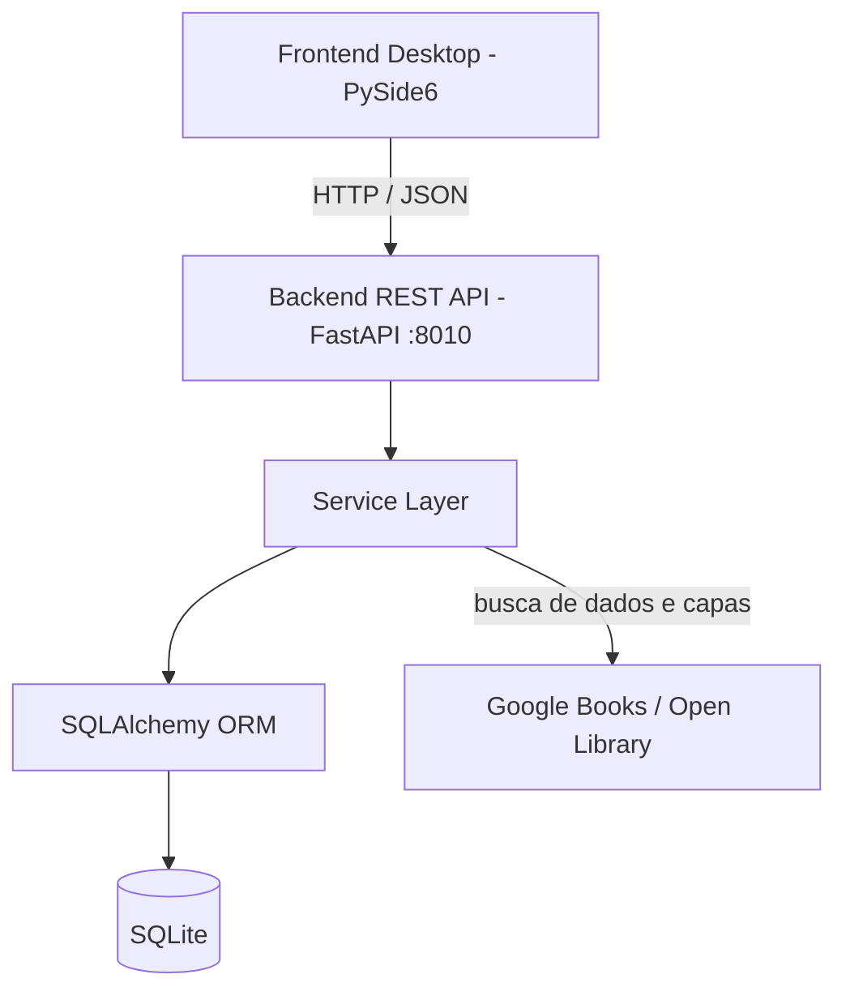

# 📚 BookRoomLog

<div align="center">


**Seu registro pessoal de leituras: o que você quer ler, a fila de próximos, o que está lendo e o anuário de tudo que já leu.**

</div>

---

## 📖 Sobre o Projeto

O **BookRoomLog** é um aplicativo desktop para registrar seus livros. Ele é o irmão do
[GameRoomLog](https://github.com/FabricioPereira008/GameRoomLog) e usa a mesma arquitetura: interface em
**PySide6 (Qt)** falando com uma **API REST em FastAPI**, tudo rodando localmente com **SQLite**.

O app não tenta medir tempo de leitura (o Kindle não informa isso de forma útil): cada livro guarda o
status, o progresso em % enquanto você lê e, quando termina, a **data de término** e a sua **nota**.

---

## ✨ Funcionalidades

- 📚 **Estante:** o que você está lendo em destaque (com a barra de progresso) e faixas com os próximos da fila, a lista de quero ler e os lidos recentemente.
- 🔢 **Fila de Próximos:** ordem manual (arrastando ou com os botões), e "Começar a ler" com um clique.
- 🔍 **Buscar dados online:** pelo título/autor ou ISBN no **Google Books** (com a **Open Library** como alternativa), preenchendo autor, editora, páginas, idioma, ISBN e capa.
- ⭐ **Nota e término:** nota de 0 a 10 (meio ponto) e data de término, que vem preenchida com o dia de hoje.
- 🔁 **Releituras:** cada nova leitura é um registro ligado ao original, com nota e data próprias, e entra no Anuário do ano em que foi lida.
- 📅 **Anuário de leitura:** livros e páginas lidos por ano, média de notas, livros por mês, gêneros, autores e formatos mais lidos, destaques e o pódio do ano (top 3).
- 🏷️ **Autores, Gêneros, Séries e Editoras:** páginas com mosaico de capas e os livros de cada uma, com autocompletar no cadastro (nomes novos são criados na hora).
- 📋 **Biblioteca em tabela:** busca por título/autor/série e filtros por status, gênero e formato; colunas ordenáveis e ocultáveis.
- 💾 **Backups:** automático (1 por dia, ao abrir), manual, restauração e exportação/importação em `.zip` (banco + capas).
- ⌨️ **Atalhos:** `Ctrl+N` (novo livro), `Ctrl+F` (busca rápida), `Del` (excluir o selecionado).

### Status de um livro

| Status | Significado | Campos extras |
|---|---|---|
| **Quero Ler** | Está na lista para ler um dia | — |
| **Próximo** | Na fila, em uma ordem que você define | posição na fila |
| **Lendo** | Leitura em andamento | progresso (%) |
| **Lido** | Terminado | data de término e nota |

---

## 🏛️ Arquitetura



A API local usa a porta **8010** (o GameRoomLog usa a 8000), então os dois apps podem ficar abertos juntos.

---

## 🚀 Como Executar

### Pré-requisitos
- **Python 3.11 ou superior**.

### 1. Criar e ativar o ambiente virtual

```bash
python3 -m venv venv
source venv/bin/activate          # Windows: .\venv\Scripts\Activate.ps1
```

### 2. Instalar as dependências

```bash
pip install --upgrade pip
pip install -r requirements-dev.txt -c constraints-build.txt
```

> As versões de `constraints-build.txt` são as validadas no build (o PySide 6.12 derruba o processo ao fim dos testes).

### 3. Iniciar a aplicação

```bash
python desktop_launcher.py        # backend embutido + interface (recomendado)
python run_dev.py                 # desenvolvimento: QSS ao vivo e reinício automático
```

Ou em terminais separados: `python backend/run_server.py` e `python frontend_desktop/main_app.py`
(com `PYTHONPATH` apontando para a raiz do projeto).

### Google Books (opcional)

Sem chave, o Google Books divide uma cota pequena com todo mundo e às vezes recusa a busca. Nesse caso o app usa a
Open Library automaticamente. Para buscas mais confiáveis, crie uma chave gratuita no Google Cloud (API "Books") e
informe-a em **Configurações → Busca e capas** (ou em `GOOGLE_BOOKS_API_KEY` no `.env`).

---

## 🧪 Testes e Qualidade

```bash
pytest                                                               # todos os testes
pytest --cov=backend/app --cov=frontend_desktop --cov-report=term-missing
ruff check .
```

O hook de pré-commit (`./scripts/install-hooks.sh`) roda o ruff e os testes antes de cada commit, e o CI
(`.github/workflows/ci.yml`) exige pelo menos 85% de cobertura.

---

## 📦 Pacotes Distribuíveis

```bash
./scripts/build_appimage.sh       # Linux: dist/BookRoomLog-x86_64.AppImage
scripts\build_windows.bat         # Windows: dist\BookRoomLog-Windows-x64.zip
```

Um push de tag `v*` também gera os dois pacotes no GitHub Actions (`.github/workflows/build-release.yml`).

---

## 📂 Estrutura

```text
BookRoomLog/
├── backend/                  # API REST (FastAPI)
│   ├── app/
│   │   ├── api/v1/          # Rotas (livros, categorias, estatísticas, busca, uploads, backups)
│   │   ├── core/            # Configuração, banco, migrações, proteção de downloads
│   │   ├── models/          # Entidades SQLAlchemy
│   │   ├── schemas/         # Modelos Pydantic
│   │   └── services/        # Regras de negócio
│   ├── migrations/          # Alembic
│   └── tests/
├── frontend_desktop/         # Interface desktop (PySide6)
│   ├── api_client/          # Cliente HTTP
│   ├── models/              # Models Qt (lista e tabela)
│   ├── styles/              # Tokens e tema escuro (QSS)
│   ├── views/               # Telas, componentes e diálogos
│   └── tests/
├── resources/                # Ícones, fontes e .desktop
├── scripts/                  # Build e hook de pré-commit
├── desktop_launcher.py       # Inicializador (backend embutido + UI)
├── bookroomlog.spec          # Configuração do PyInstaller
└── app_version.py            # Fonte única da versão
```

---

## 📄 Licença

Este projeto está sob a licença [MIT](LICENSE).
